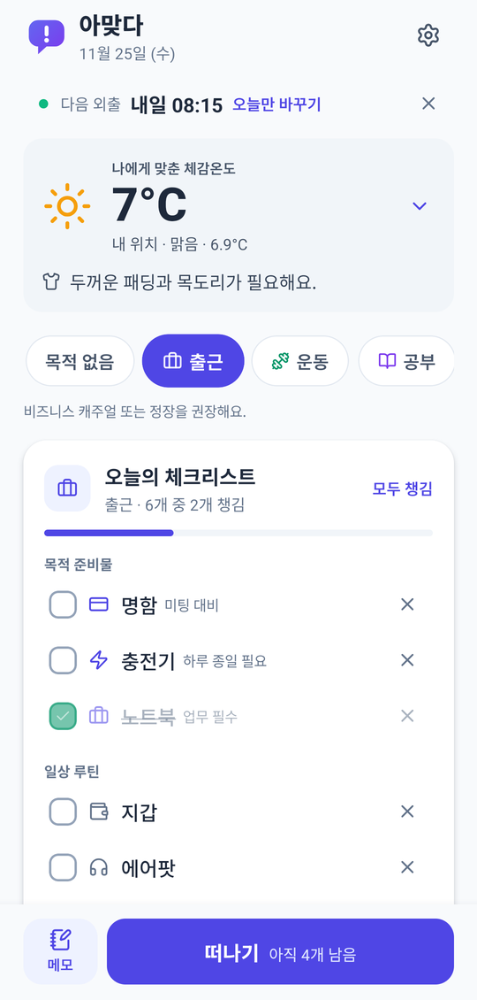
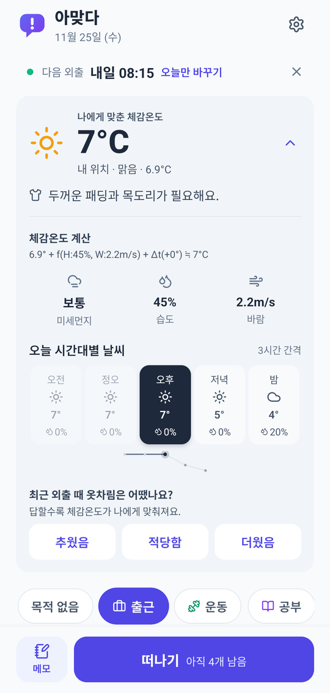
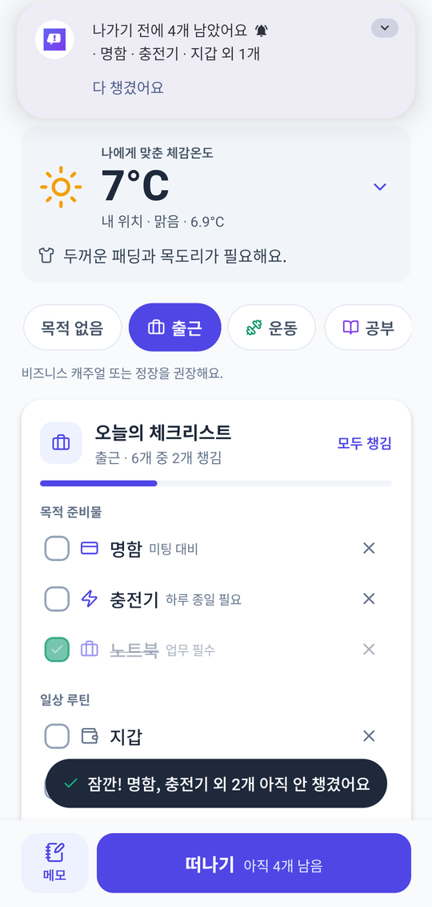
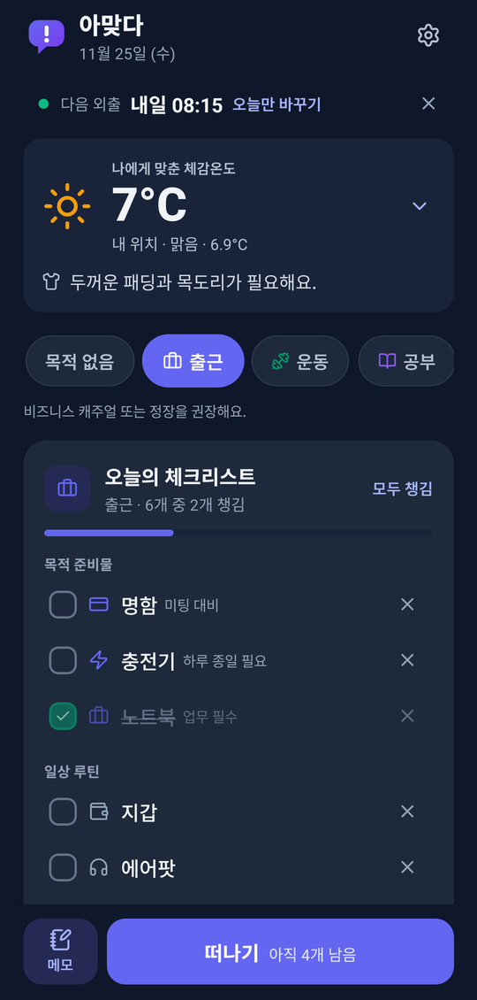
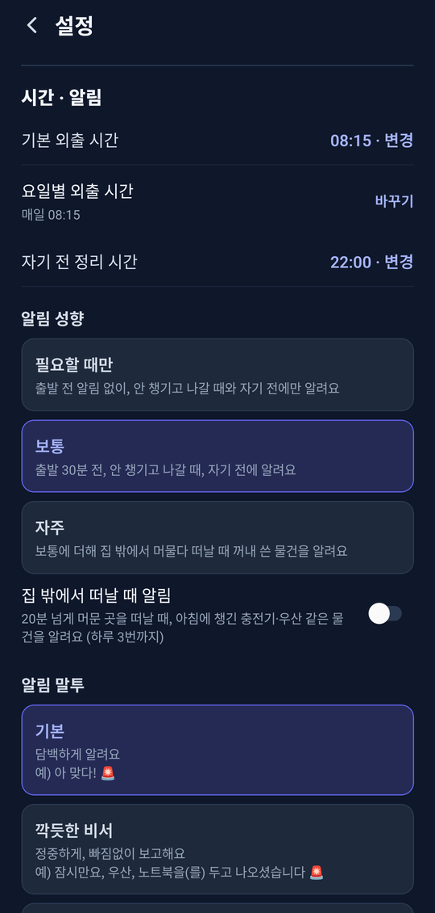
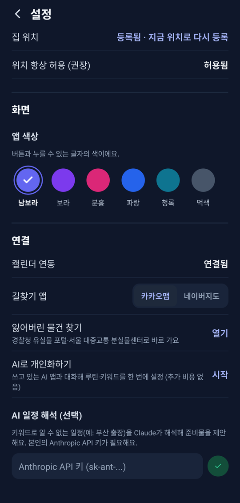

# 아맞다

> 지하철에서 뒤늦게 나오는 "아, 맞다!"를 현관 앞에서 먼저 말해 주는 외출 준비 앱

**아맞다**는 오늘의 날씨·일정을 읽어 챙길 것을 자동으로 정리하고, 집을 나서는 순간 아직 안 챙긴 것이 있으면 먼저 알려 줍니다. 사용자는 목록을 직접 적는 대신 앱이 만든 목록을 확인만 합니다.

## 스크린샷

<table>
  <tr>
    <td align="center"></td>
    <td align="center"></td>
    <td align="center"></td>
  </tr>
  <tr>
    <td align="center"><b>오늘의 체크리스트</b><br>목적(출근)을 고르면 준비물이 자동으로 붙음</td>
    <td align="center"><b>나에게 맞춘 체감온도</b><br>계산 근거와 시간대별 예보, 옷차림 피드백</td>
    <td align="center"><b>떠나기</b><br>안 챙긴 게 남아 있으면 알림으로 한 번 더</td>
  </tr>
  <tr>
    <td align="center"></td>
    <td align="center"></td>
    <td align="center"></td>
  </tr>
  <tr>
    <td align="center"><b>다크 모드</b><br>기기 설정을 따름</td>
    <td align="center"><b>설정 · 시간과 알림</b><br>요일별 외출 시간, 알림 성향, 알림 말투</td>
    <td align="center"><b>설정 · 화면과 연결</b><br>앱 색상 6가지, 길찾기 앱, AI 연결</td>
  </tr>
</table>

<p align="center">
  <br>
  <b>Android 홈 위젯</b> — 출발 시각과 아직 안 챙긴 것, 바로 떠나기
</p>

<sub>Android 에뮬레이터에서 찍은 화면입니다 (2026-11-25).</sub>

## 왜 만들었나

| 문제 | 기존 도구의 한계 |
|---|---|
| 챙길 것이 날씨·일정에 따라 매일 달라진다 | 할 일·메모 앱은 매번 직접 판단해서 적어야 한다 |
| 정작 나갈 때는 앱을 열지 않는다 | 알림이 정해진 시각에만 오거나, 앱을 열어야 보인다 |
| 같은 날씨도 사람마다 다르게 느낀다 | 날씨 앱은 모두에게 같은 체감온도를 보여 준다 |

## 주요 기능

### 오늘의 체크리스트
네 가지 출처에서 매일 자동으로 조립됩니다.

- **날씨 준비물** — 비 예보면 우산, 미세먼지 나쁨·매우나쁨이면 마스크, 폭염이면 물병
- **외출 목적 준비물** — 캘린더 일정 제목으로 목적(출근·운동·공부·약속·여행)을 감지해 노트북, 운동복 같은 준비물을 붙임
- **일상 루틴** — 집 열쇠·지갑처럼 매번 챙기는 것, 요일별 지정 가능
- **오늘만** — 그날 직접 추가한 항목 (음성으로도 추가 가능)

자동으로 들어간 항목은 언제든 끄거나 바꿀 수 있고, 목록이 다시 만들어져도 체크한 상태는 유지됩니다.

### 나에게 맞춘 체감온도
기상청 단기예보와 에어코리아 대기질을 받아 `기온 + 습도 보정 + 바람 보정 + 개인 보정치`로 계산합니다. 외출 후 "추웠음·적당함·더웠음" 피드백이 쌓이면 개인 보정치가 조정되고, 시간대별 예보와 계산 근거를 함께 보여 줍니다.

### 외출 감지와 알림
- **[떠나기] 버튼** — 나가기 전 마지막 확인. 남은 것이 있으면 짧게 한 번 보여 줌 (앱·잠금화면 알림·홈 위젯)
- **나가는 순간 알림** — 걷기 감지·집 위치 이탈을 주 신호로, Wi-Fi 연결 끊김을 보조 신호로 묶어 외출을 판정하고 안 챙긴 게 남아 있으면 알림
- **자기 전 정리** — 사용자가 정한 시각에 내일 일정·날씨로 챙길 것을 미리 보여 주고 오늘 옷차림 피드백을 받음
- **집 밖 장소에서 떠날 때 알림** (선택) — 카페 등에 머물다 일어설 때도 확인

### 그 밖에
- **길찾기 바로가기** — 오늘 일정 장소로 지도 앱 길찾기를 바로 엶
- **AI 연결 (선택)** — 키워드로 못 알아본 일정을 해석해 준비물 제안. 기본은 꺼져 있고 사용자가 켤 때만 동작하며, 실패해도 핵심 기능엔 영향 없음
- **다크 모드** — 기기의 밝은/어두운 화면 설정을 따름
- **Android 홈 위젯** — 출발 상태와 아직 안 챙긴 것을 한 줄로

## 원칙

1. **속도·간편함이 정교함보다 먼저** — 나가기 직전 몇 초 안에 확인하는 앱
2. **입력이 아니라 확인** — 목록은 앱이 만들고 사용자는 승인·수정만
3. **알림은 시각이 아니라 상황에 맞춘다** — 이미 나간 뒤의 알림은 늦다
4. **광고 없음**
5. **모든 자동 판단은 사용자가 덮어쓸 수 있다**

## 기술 스택

- **앱**: React Native 0.86, React 19, Expo SDK 57 (네이티브 폴더를 직접 관리하는 bare workflow), TypeScript
- **상태**: Zustand + AsyncStorage
- **알림·백그라운드**: Notifee, react-native-background-fetch, expo-task-manager, expo-location(지오펜싱)
- **네이티브 모듈 (Kotlin)**: `modules/ahmatda-motion`(걷기 감지), `modules/ahmatda-widget`(홈 위젯)
- **외부 데이터**: 기상청 단기예보 API, 에어코리아 대기오염정보 API, 기기 캘린더
- **테스트**: Jest

```
src/
  screens/       대시보드 · 설정 · 온보딩
  components/    공용 UI
  store/         체크리스트 조립과 앱 상태
  services/      날씨 · 대기질 · 캘린더 · 외출 감지 · 알림 · 자기 전 정리 · AI
  constants/     목적 · 색 · 디자인 기준
modules/         Kotlin 네이티브 모듈
android/ ios/    네이티브 프로젝트
```

## 실행하기

**준비물**: Node.js, Android Studio(JDK 21 포함), Android 기기 또는 에뮬레이터

```bash
npm install
cp .env.example .env    # 공공데이터포털에서 받은 기상청·에어코리아 키 입력
npm run android         # 개발 빌드 설치 후 실행
```

- 키를 비워 두면 날씨·미세먼지 정보 없이 나머지 기능만 동작합니다.
- 설치된 개발 빌드는 `npm start`로 Metro 서버에 붙습니다.
- 테스트: `npm test`, 타입 검사: `npm run typecheck`

> iOS 프로젝트도 들어 있지만 아직 실기기에서 확인하지 않았습니다.

## 상태

개발 중입니다. 외출 감지와 알림은 실기기 검증을 진행하고 있습니다.
